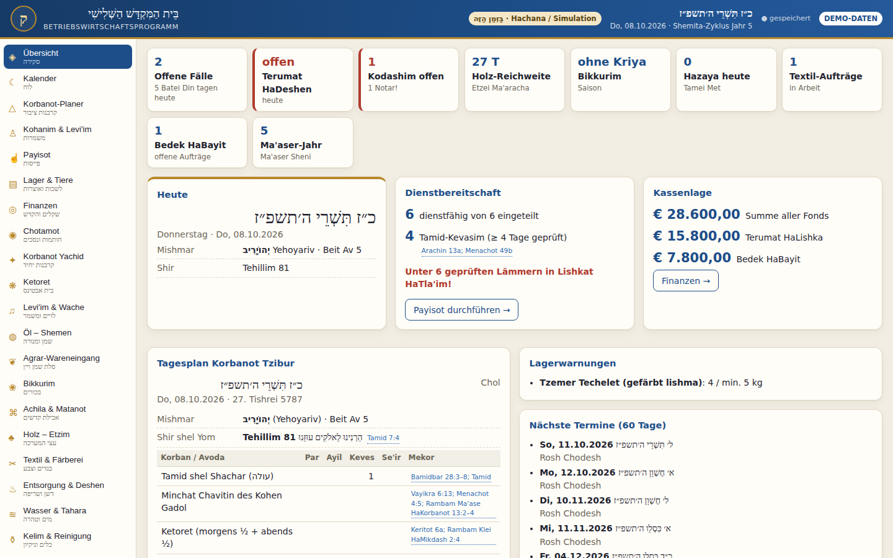
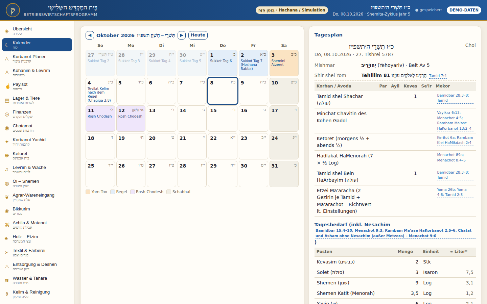
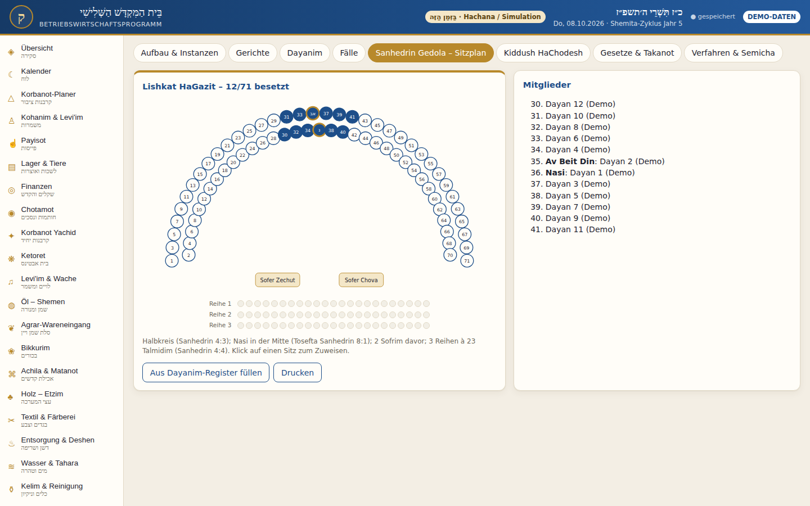
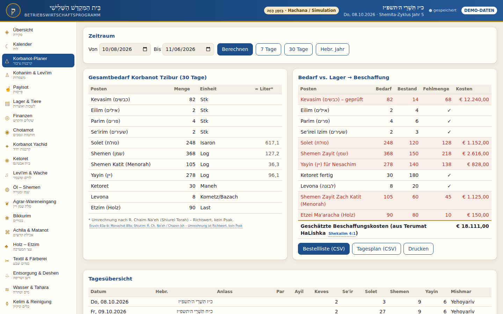
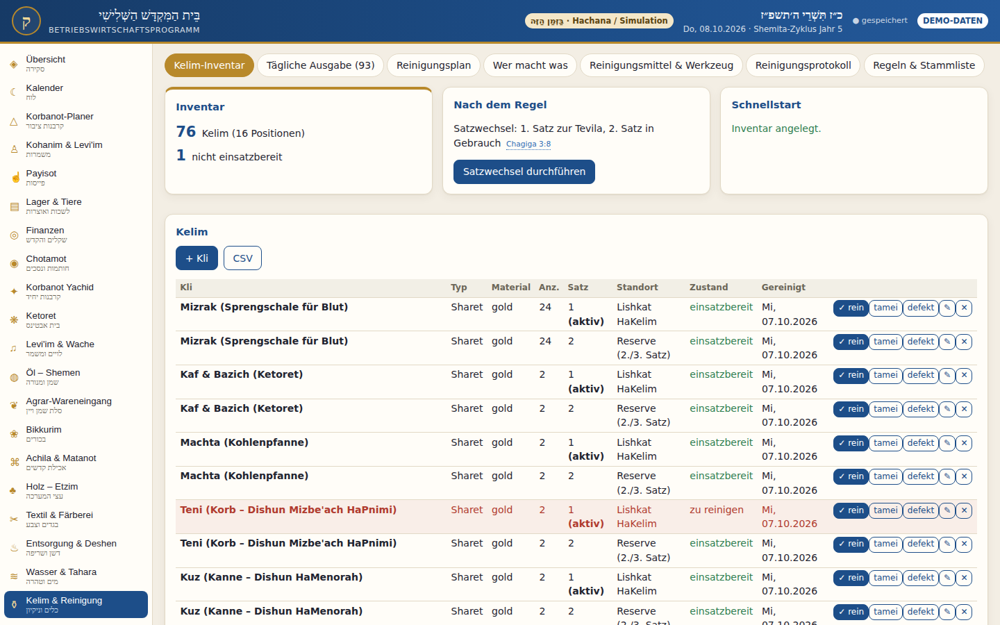

# מִנְהַל הַמִּקְדָּשׁ · Minhal HaMikdash

**Betriebswirtschaftsprogramm für den בֵּית הַמִּקְדָּשׁ הַשְּׁלִישִׁי**

Ein Verwaltungsprogramm für den gesamten Tempeldienst – vom Tamid über Mishmarot, Lager, Finanzen und Kelim bis zum Beit Din. Jede halachische Stammangabe trägt ihren **Mekor** aus Mishna, Gemara oder Rambam.

### ▶ [Programm im Browser öffnen](https://moriahise.github.io/Minhal-haMikdash/)

Keine Installation, kein Konto, kein Server. Läuft auf PC, Tablet und Handy.



---

## Grundsatz

Strikte Trennung zwischen **בַּזְּמַן הַזֶּה** (Hachana, Lernen, Simulation) und **לֶעָתִיד לָבוֹא** (Betrieb – ausschließlich nach Psak eines anerkannten Beit Din HaGadol). Das Programm startet im Modus *Hachana / Simulation*.

Wo Shitot auseinandergehen (Shiurim, Bal Te'acher, Ketoret-Teilmengen, Mishmar-Rotation), rechnet das Programm sichtbar nach einer Shita und markiert die Stelle. Angaben mit **„(prüfen)“** sind Quellenstellen, die vor einer Verwendung nachgeschlagen werden sollten. **Das Programm rechnet – es ersetzt keinen Psak.**

---

## Module

| Bereich | Inhalt |
|---|---|
| **Übersicht** | Hebräisches Datum, Mishmar und Beit Av, Shir shel Yom, Tagesplan, Warnungen, Termine |
| **Kalender & Korbanot-Planer** | Korbanot Tzibur nach Bamidbar 28–29 inkl. Nesachim, Bedarf vs. Lager, Beschaffung, CSV |
| **Kohanim & Levi'im · Payisot** | 24 Mishmerot, Batei Av, Tum'a, Mumim, die 4 Payisot (Yoma 2) mit Fingerzählung |
| **Levi'im & Wache** | Shir-Dienstplan mit Mindestbesetzung (Arachin 2), 24 Wachposten (Middot 1:1), Ma'aser Rishon |
| **Lager, Agrar, Öl, Holz** | Lishkot, Tierregister (Bikur Mumim), Wareneingang nach Menachot 8, 9 Ölsorten, Kurban Etzim |
| **Finanzen · Chotamot · Hekdesh** | 13 Shofarot, Machatzit HaShekel, Terumat HaLishka, Chotamot (Shekalim 5), Arachin, Me'ila |
| **Korbanot Yachid · Achila · Bikkurim** | Bal-Te'acher-Fristen, Korban-Pesach-Chaburot, Verzehrfristen (Zevachim 5), Matanot Kehuna |
| **Ketoret** | Rezepturrechner (Keritot 6a), Chargen Beit Avtinas |
| **Textil · Entsorgung · Tahara** | Bigdei Kehuna & Färberei, Terumat HaDeshen & Sereifa, Efer Para Aduma & Hazaya-Plan |
| **Kelim & Reinigung** | Kelei Sharet mit 1./2./3. Satz (Chagiga 3:8), tägliche Ausgabe der 93 Kelim, Reinigungsplan |
| **Baumaterial · Werkzeug · Metalle** | Bauregeln (Rambam Beit HaBechira 1), Schmiede, Bedikat HaSakin, Metallbuch, Farben |
| **Körperpflege · Transport · Büro** | Haarschnitt/Pru'a Rosh, Seife, Unterkunft, Dienstreisen, Pergament- und Tintenherstellung |
| **Beit Din & Sanhedrin** | 3 / 23 / 71, Gerichte an den Toren (Sanhedrin 11:2), Instanzenweg, Sitzplan der 71, Kiddush HaChodesh |
| **Bibliothek & Sofrim** | Katalog, Hagaha, Ausleihe, Genizah, Shtarot |
| **Sedarim · Nachschlagewerk** | Checklisten (Tamid, Yom Kippur, Pesach, Sukkot …), alle Stammdaten mit Mekor |

<p>




</p>

---

## Daten

- Alle Eingaben werden **nur im Browser des jeweiligen Geräts** gespeichert (localStorage). Es gibt keinen Server, nichts wird hochgeladen.
- Jeder Besucher der Webseite hat dadurch seine **eigenen, getrennten Daten**.
- Daten zwischen Geräten übertragen: *Einstellungen → Sicherung exportieren (.json)* und auf dem anderen Gerät importieren.
- Beim ersten Öffnen kann ein **Demo-Datensatz** geladen werden.

## Lokal verwenden (Windows)

Repository als ZIP herunterladen (*Code → Download ZIP*), entpacken und **`Start_BeitHaMikdash.bat`** doppelklicken. Das Programm öffnet sich als eigenes Fenster in Edge oder Chrome – ohne Internet.

## Aufbau

```
index.html            Weiterleitung auf app/ (GitHub Pages)
app/
  index.html          Programmoberfläche
  style.css
  data.js, data2.js   Halachische Stammdaten mit Mekor  ← hier anpassen
  core.js             Kalender, Berechnungen, Datenhaltung
  app.js              Grundmodule
  module2–7.js        Erweiterte Module
Start_BeitHaMikdash.bat   Starter für Windows (lokal)
LIESMICH.txt          Kurzanleitung
docs/screenshots/     Bilder für diese Seite
```

Reines HTML, CSS und JavaScript ohne Abhängigkeiten oder Build-Schritt. Die Stammdaten in `app/data.js` und `app/data2.js` lassen sich mit jedem Texteditor bearbeiten.

## Quellen

Mishna, Bavli und Yerushalmi, Tosefta sowie Mishne Torah des Rambam (v. a. Hilchot Beit HaBechira, Klei HaMikdash, Bi'at HaMikdash, Ma'ase HaKorbanot, Temidin uMusafin, Shekalim, Sanhedrin). Die jeweilige Stelle steht im Programm bei jeder Angabe.
